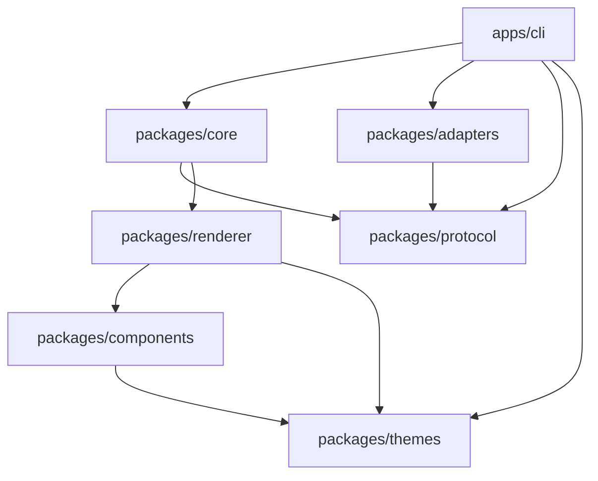

# AOE Architecture Specification

## 1. System Overview

**AOE (Agent Output Enhancement)** is a presentation enhancement system for AI coding agents operating in terminal and CLI environments. It cleanly separates agent reasoning from presentation concerns through two complementary components:

1. **Portable Skill (`skills/aoe`)**: A structured instruction system that agents ingest to format output with strict hierarchy, deterministic progress, and zero hallucination.
2. **Terminal Engine (`packages/*`, `apps/cli`)**: A modular presentation engine that receives a versioned JSONL event stream and renders an interactive, themeable terminal UI.

When the Engine is present, the Skill streams protocol events for rich rendering. When absent, the Skill falls back to clean, native terminal markdown.

## 2. Monorepo Organization

```
aoe/
├── apps/
│   └── cli/                # Command-line interface executable (aoe)
├── packages/
│   ├── protocol/           # Zod event schemas, envelopes, and validation
│   ├── themes/             # Theme tokens, Obsidian and Light palettes
│   ├── components/         # Terminal presentation components
│   ├── renderer/           # Terminal screen & Ink rendering orchestrator
│   ├── core/               # State machine, session manager, event processor
│   └── adapters/           # Agent ingestion adapters (Codex, Claude, Gemini, etc.)
├── skills/
│   └── aoe/                # Portable AI agent skill definition
│       ├── SKILL.md
│       ├── references/
│       └── examples/
└── docs/                   # Architectural & engineering documentation
```

## 3. Package Boundaries & Dependency Graph



### Invariants:

- `packages/protocol` depends only on `zod` and has zero internal monorepo dependencies.
- `packages/themes` defines token primitives independent of rendering engines.
- `packages/components` and `packages/renderer` contain visual presentation logic.
- `packages/core` contains business logic, session lifecycle, and state transitions.
- `packages/adapters` isolates agent-specific quirks from the core protocol.
- `apps/cli` wires together adapters, core, and renderer into an executable.

## 4. Universal Event Protocol Structure

All events emitted or ingested by AOE conform to the following schema envelope:

```typescript
export interface ProtocolEnvelope<T = unknown> {
  protocol: 'aoe';
  version: '1.0.0';
  timestamp: string; // ISO 8601 UTC
  sessionId: string; // Unique session identifier
  sequence: number; // Monotonically increasing sequence number (0-indexed)
  event: string; // Dot-notated domain event (e.g. task.start, file.diff)
  data: T; // Typed payload validated against schema
}
```

## 5. Non-Functional Requirements

- **Zero Hallucination**: No component may fabricate status, fake execution times, or report unverified completions.
- **Terminal Compatibility**: Graceful degradation from 24-bit Truecolor to ANSI-256, ANSI-16, and ASCII non-TTY streams.
- **Safety**: AOE never executes arbitrary code or shell commands automatically without explicit user intervention.
- **Privacy**: Internal chain-of-thought blocks or private scratchpad tokens are stripped before rendering.
