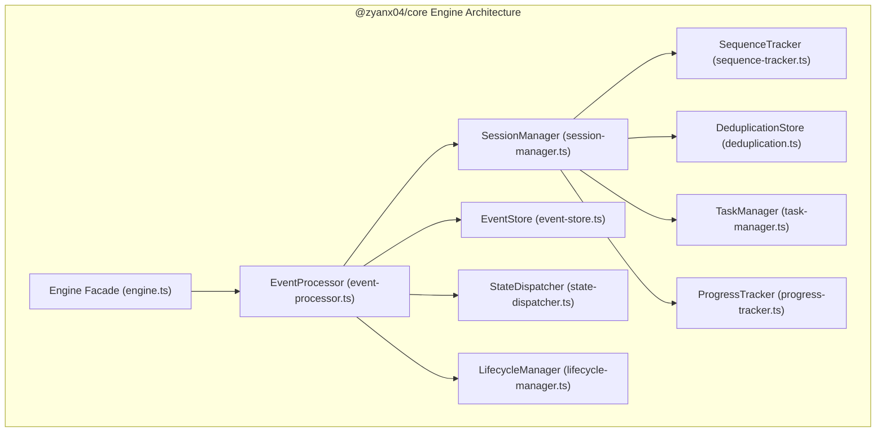

# AOE Core Engine Architecture

## 1. Overview

The **AOE Core Engine** (`@zyanx04/core`) is the stateful orchestration and event processing foundation of AOE. It ingests validated `AoeEvent` streams adhering to the Universal Event Protocol (`v1.0.0`), enforces session and task lifecycles, tracks sequence numbers, eliminates duplicate events, manages task hierarchies, and maintains an in-memory event store.

---

## 2. Module Decomposition



### Module Responsibilities

| Module                   | Responsibility                                                        | Invariant                                                                                               |
| :----------------------- | :-------------------------------------------------------------------- | :------------------------------------------------------------------------------------------------------ |
| **`SessionManager`**     | Manages concurrent sessions, metadata, and lifecycle containers       | Sessions are isolated; cross-session state corruption is impossible                                     |
| **`SequenceTracker`**    | Sequence evaluation, duplicate detection, bounded out-of-order buffer | Enforces strict sequence increments (`0, 1, 2...`); drains contiguous buffered events                   |
| **`DeduplicationStore`** | Event ID tracking and content hash comparison                         | Identical duplicates are idempotent; conflicting duplicates are rejected with `ConflictingEventIdError` |
| **`LifecycleManager`**   | State machine transition validator for sessions and tasks             | Prevents transitions out of terminal states (`completed`, `failed`)                                     |
| **`TaskManager`**        | Hierarchical task trees, parent-child links, depth calculation        | Detects cycles via `CircularTaskHierarchyError`; prevents duplicate registrations                       |
| **`ProgressTracker`**    | Mathematical integrity validation for progress updates                | Never fabricates progress; completed work cannot exceed total work for verified milestones              |
| **`EventStore`**         | In-memory event storage with ID lookups and filtered queries          | Bounded storage per session (default 10,000 events) with FIFO eviction                                  |
| **`StateDispatcher`**    | Notifies registered session or global subscribers                     | Isolates listener exceptions; delivers immutable snapshot views                                         |
| **`EventProcessor`**     | Atomic transactional pipeline coordinator                             | Zero partial mutations on rejected events                                                               |

---

## 3. Public Engine API

```typescript
import { Engine } from '@zyanx04/core';
import { createEvent } from '@zyanx04/protocol';

const engine = new Engine({
  maxBufferSize: 100,
  maxEventsPerSession: 10000,
});

// 1. Subscribe to state updates
const unsubscribe = engine.subscribe('sess_100', (snapshot, event) => {
  console.log(
    `[${snapshot.status}] Tasks: ${snapshot.completedTaskCount}/${snapshot.stats.tasksTotal}`,
  );
});

// 2. Process protocol event
const result = engine.processEvent(
  createEvent('session.started', {
    sessionId: 'sess_100',
    sequence: 0,
    payload: { agent: { name: 'claude-code' }, workingDirectory: '/app' },
  }),
);

// 3. Inspect immutable state snapshot
const snapshot = engine.getSessionSnapshot('sess_100');

// 4. Dispose engine
engine.dispose();
```
