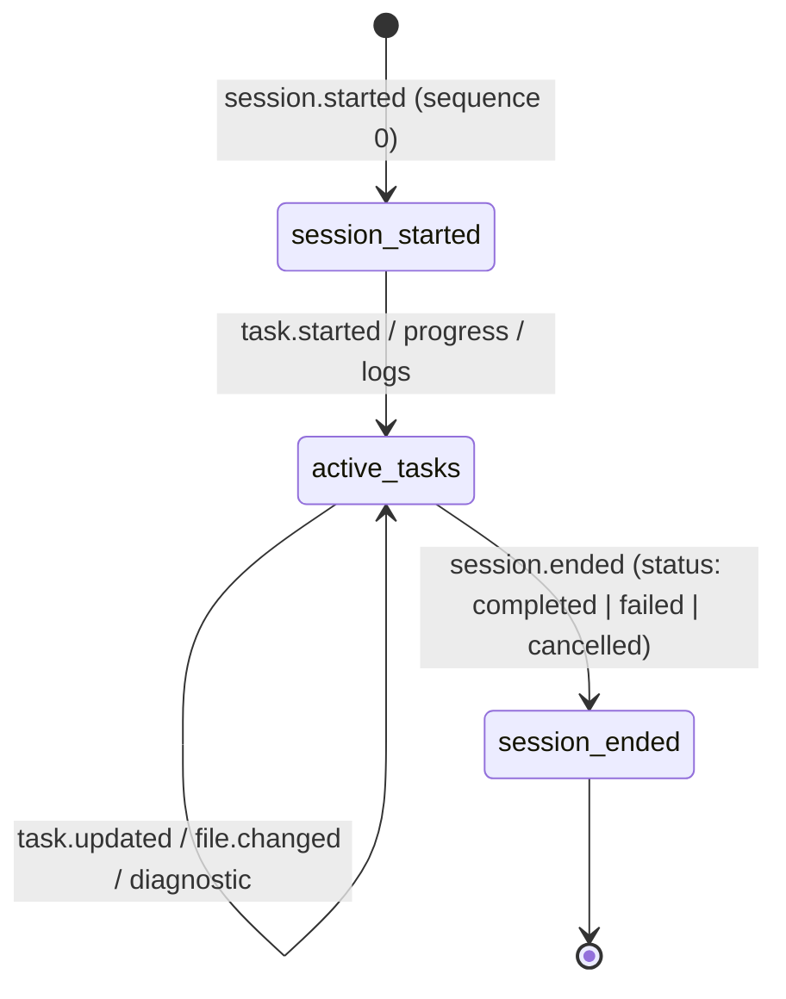
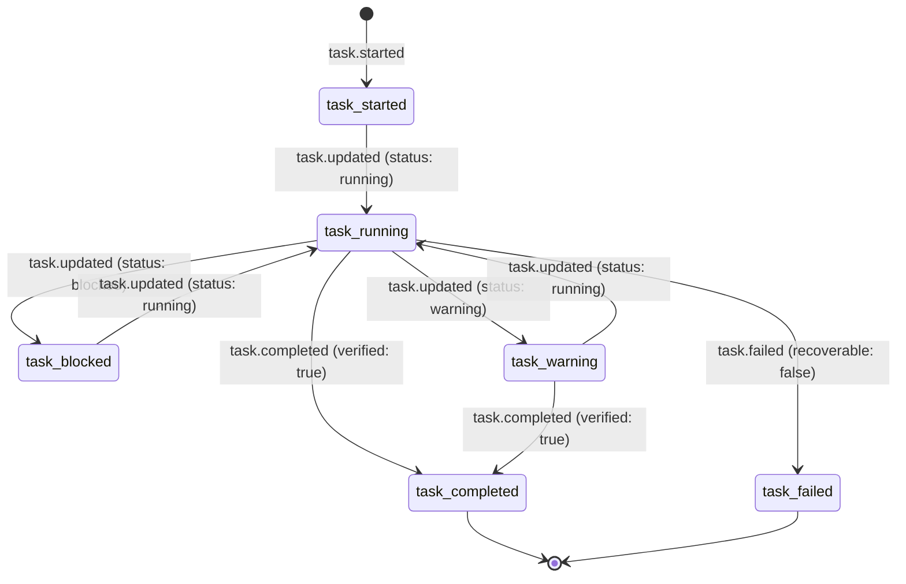

# AOE Universal Event Protocol — Lifecycle & Semantic Rules

## 1. Overview & Separation of Concerns

The AOE protocol maintains a strict separation between **Schema Validation** and **Lifecycle Validation**:

```
┌─────────────────────────────────────────────────────────────────┐
│                      Stateless Protocol Layer                   │
│              (@aoe/protocol — Implemented in M02)               │
│                                                                 │
│  - Validates individual event envelope syntax and data types.   │
│  - Validates field constraints (e.g. sequence ≥ 0, lineDelta).  │
│  - Validates internal payload refinements (e.g. completedWork). │
└────────────────────────────────┬────────────────────────────────┘
                                 │ Validated Events
                                 ▼
┌─────────────────────────────────────────────────────────────────┐
│                    Stateful Core Engine Layer                   │
│                (@aoe/core — Implemented in M03)                 │
│                                                                 │
│  - Tracks active sessions and task tree hierarchies.            │
│  - Enforces sequence continuity (no sequence gaps or drops).    │
│  - Enforces state machine transitions (started ➔ completed).   │
│  - Manages deduplication and session termination barriers.      │
└─────────────────────────────────────────────────────────────────┘
```

---

## 2. Session Lifecycle

Every AOE stream begins with a single `session.started` event and concludes with a `session.ended` event:



### Invariants:

1. **Sequence Zero Requirement**: `session.started` must be emitted with `sequence: 0`.
2. **Terminal Session Barrier**: Once `session.ended` is emitted for a given `sessionId`, no subsequent events referencing that `sessionId` are accepted.
3. **Session Identity Uniformity**: All events within a given stream must carry the identical `sessionId`.

---

## 3. Task Lifecycle State Machine

Tasks represent discrete units of work within a session. Each task follows a strictly monotonic lifecycle:



### Invariants:

1. **Prior Start Requirement**: `task.updated`, `task.completed`, and `task.failed` must reference an active `taskId` initiated via `task.started`.
2. **Verification Requirement for Completion**: `task.completed` must carry `verified: true`. An agent may never emit `task.completed` without affirmative verification evidence.
3. **Terminal Task Immutability**: Once a task transitions to `task.completed` or terminal `task.failed`, it cannot transition back to `task.updated`.

---

## 4. Sequence Number Semantics

1. **Zero-Indexed**: The first event in any session has `sequence = 0`.
2. **Strict Monotonicity**: Every subsequent event in the session must increment the sequence number by exactly 1 (`0, 1, 2, 3, ...`).
3. **Out-of-Order Handling**: The core engine (M03) rejects or re-orders out-of-order sequence arrivals.

---

## 5. Timestamp Semantics

1. **Format**: Every event timestamp must be an ISO 8601 UTC string with millisecond precision (`YYYY-MM-DDTHH:mm:ss.sssZ`).
2. **Non-Decreasing Progression**: Successive events in an ordered sequence must not travel backward in time (accounting for sub-millisecond clock resolution).
3. **UTC Universal Standard**: All timestamps must be in UTC (`Z` zone). Local timezone offsets are disallowed in the wire protocol.

---

## 6. Duplicate Event Handling & Idempotency

1. **Idempotency Key (`eventId`)**: Every event must carry a unique `eventId`.
2. **Deduplication Expectations**:
   - If an engine receives an event with an `eventId` already processed for that session, it must treat the event as an idempotent duplicate and safely discard it without double-applying state mutations.
   - If an engine receives duplicate sequence numbers with conflicting `eventId`s, the engine raises an operational error.

---

## 7. Invalid Lifecycle Sequence Examples

### Example 1: Task Completed Without Prior Start

```json
{
  "protocolVersion": "1.0.0",
  "eventId": "evt_1",
  "sessionId": "sess_1",
  "sequence": 1,
  "timestamp": "2026-11-03T10:00:00.000Z",
  "eventType": "task.completed",
  "payload": { "taskId": "task_phantom", "resultSummary": "Done", "verified": true }
}
```

_Lifecycle Violation_: `task_phantom` was never registered via `task.started`.

### Example 2: Premature Completion Without Verification

```json
{
  "protocolVersion": "1.0.0",
  "eventId": "evt_2",
  "sessionId": "sess_1",
  "sequence": 2,
  "timestamp": "2026-11-03T10:00:01.000Z",
  "eventType": "task.completed",
  "payload": { "taskId": "task_01", "resultSummary": "Code written", "verified": false }
}
```

_Lifecycle Violation_: `verified` must be `true` for `task.completed`. Code written without verification remains `task.updated` (`status: running` or `warning`).

### Example 3: Event Emitted After Session End

```json
{
  "protocolVersion": "1.0.0",
  "eventId": "evt_3",
  "sessionId": "sess_1",
  "sequence": 12,
  "timestamp": "2026-11-03T10:05:01.000Z",
  "eventType": "log.emitted",
  "payload": { "level": "info", "message": "Aftermath log" }
}
```

_Lifecycle Violation_: Event emitted after sequence 11 (`session.ended`).
