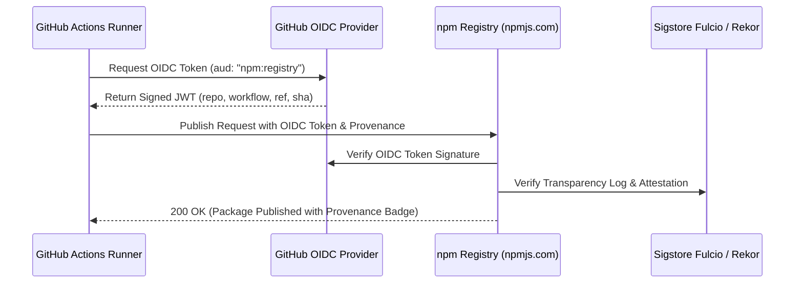

# M06.3 — AOE Release Readiness & Publishing Preparation Audit Report

## Document Metadata

- **Project**: AOE — Agent Output Enhancement
- **Milestone**: M06.3 — Release Readiness & Publishing Preparation
- **Classification**: **CONDITIONAL PASS** (Ready for publication pending external npm account UI configuration and atomic version bump)
- **Repository**: `https://github.com/zulian026/aoe.git`
- **Workspace**: `/home/zyan/Projects/aoe`
- **Baseline Commit**: `92f3910`
- **Author**: Senior Release Engineer, Node.js Package Distribution Architect, and Supply Chain Security Auditor
- **Date**: 2026-11-05
- **Status**: AUDITED & VERIFIED (Preparation and Verification Only — AOE Remains Unpublished)

---

## 1. Executive Summary

Milestone **M06.3** conducted an exhaustive, evidence-based release-readiness audit and publication preparation for AOE (Agent Output Enhancement). The audit evaluated the repository state following the completion of M06.2 (Production Packaging & Distribution Implementation), inspecting package metadata, tarball composition, version consistency, Changesets configuration, GitHub Actions release workflows, OpenID Connect (OIDC) / Trusted Publishing mechanics, dependency supply chain security, and cross-platform verification evidence.

### Key Audit Findings

1. **Monorepo Packaging & Tarball Hygiene (Strategy D)**:
   - `@zyanx04/cli` builds into a self-contained hybrid distribution via `tsup 9.0.0`.
   - The production tarball contains exactly **23 approved production files** (1 `LICENSE`, 1 `README.md`, 1 `package.json`, 5 bundled `dist/` files, 15 portable `skills/` files) with an unpacked size of **386.4 kB** and a packed size of **89.8 kB**.
   - Zero test files, sourcemaps, `.tsbuildinfo` files, or development artifacts are packaged.
   - Zero `workspace:*` dependencies exist in runtime dependencies.
2. **Quality & Regression Testing**:
   - Static typecheck passes with **0 errors** across all seven packages.
   - The test suite executes **56 test files** with **439 passing tests (100%)**.
   - The automated clean-install verification harness (`scripts/verify-clean-install.sh`) executed and passed all **7/7 phases** in an isolated sandbox.
   - ESLint and Prettier formatting checks pass with **0 errors**.
3. **Repository URL Correction**:
   - Identified and corrected legacy placeholder URLs (`https://github.com/aoe-dev/aoe.git`, which returned HTTP 404) across all seven workspace `package.json` files, root `package.json`, and `README.md`, aligning them with the canonical repository `https://github.com/zulian026/aoe.git` (HTTP 200). This correction is mandatory for npm Provenance verification.
4. **License Synchronization**:
   - Monorepo `LICENSE` (MIT) has been copied into `apps/cli/LICENSE` and `packages/*/LICENSE`, ensuring every packaged distribution includes legal copyright notices.
5. **Release Changeset Prepared**:
   - Created `.changeset/m06-production-packaging.md` capturing all changes across the 7 fixed packages. `pnpm changeset status` exits with code 0.
6. **Publication Invariants Enforced**:
   - In strict compliance with operational constraints, **NO publishing commands were executed**. AOE remains unpublished at the end of M06.3.

---

## 2. Verified Repository Baseline

| Property                      | Verified Value                                 | Evidence                              |
| :---------------------------- | :--------------------------------------------- | :------------------------------------ |
| **Local Workspace**           | `/home/zyan/Projects/aoe`                      | Filesystem inspection                 |
| **Active Branch**             | `main`                                         | `git branch --show-current` -> `main` |
| **HEAD Commit**               | `92f3910`                                      | `git rev-parse HEAD`                  |
| **Origin Remote**             | `https://github.com/zulian026/aoe.git`         | `git remote get-url origin`           |
| **Origin HEAD**               | `1db80b4`                                      | `git rev-parse origin/main`           |
| **Existing Git Tags**         | `v0.1.0` (`9acab1f`), `v0.1.1` (`1db80b4`)     | `git tag -l`                          |
| **GitHub Releases**           | `v0.1.1` (Published Latest), `v0.1.0` (Draft)  | `gh release list`                     |
| **Published npm Version**     | `@zyanx04/cli@0.1.1` (155 files, unbundled)    | `npm view @zyanx04/cli versions`      |
| **Distribution Architecture** | Strategy D (Hybrid Bundled CLI via tsup 9.0.0) | `apps/cli/tsup.config.ts`             |
| **Local Package Versions**    | All 7 packages at `0.1.1`                      | Workspace `package.json` inspection   |

---

## 3. npm Package Metadata & Tarball Audit

### 3.1 Metadata Inspection (`apps/cli/package.json`)

```json
{
  "name": "@zyanx04/cli",
  "version": "0.1.1",
  "type": "module",
  "description": "Command-line interface for the AOE presentation engine",
  "license": "MIT",
  "publishConfig": {
    "access": "public"
  },
  "repository": {
    "type": "git",
    "url": "https://github.com/zulian026/aoe.git",
    "directory": "apps/cli"
  },
  "homepage": "https://github.com/zulian026/aoe#readme",
  "bugs": "https://github.com/zulian026/aoe/issues",
  "engines": {
    "node": ">=20.0.0"
  },
  "bin": {
    "aoe": "./dist/bin.js"
  },
  "main": "./dist/index.js",
  "types": "./dist/index.d.ts",
  "files": ["dist", "skills", "README.md", "LICENSE"],
  "exports": {
    ".": {
      "types": "./dist/index.d.ts",
      "import": "./dist/index.js"
    }
  },
  "dependencies": {
    "commander": "^13.1.0",
    "ink": "^8.0.0",
    "react": "^19.3.1",
    "yoga-layout": "^3.2.1",
    "zod": "^3.24.2"
  }
}
```

### 3.2 Production Tarball Manifest (`npm pack --dry-run`)

Execution in `apps/cli`:

```
npm notice 📦  @zyanx04/cli@0.1.1
npm notice Tarball Contents
npm notice 1.1kB LICENSE
npm notice 2.8kB README.md
npm notice 20B dist/bin.d.ts
npm notice 190B dist/bin.js
npm notice 304.8kB dist/chunk-M6FKSSBF.js
npm notice 11.4kB dist/index.d.ts
npm notice 1.6kB dist/index.js
npm notice 1.8kB package.json
npm notice 2.3kB skills/aoe/examples/code-review.md
npm notice 2.8kB skills/aoe/examples/debugging-session.md
npm notice 2.5kB skills/aoe/examples/implementation-report.md
npm notice 2.0kB skills/aoe/examples/task-completed.md
npm notice 1.8kB skills/aoe/examples/task-failed.md
npm notice 1.7kB skills/aoe/examples/task-in-progress.md
npm notice 4.1kB skills/aoe/references/command-output.md
npm notice 4.6kB skills/aoe/references/diagnostics.md
npm notice 7.9kB skills/aoe/references/engine-integration.md
npm notice 4.9kB skills/aoe/references/file-changes.md
npm notice 5.8kB skills/aoe/references/output-hierarchy.md
npm notice 4.8kB skills/aoe/references/progress-reporting.md
npm notice 5.6kB skills/aoe/references/status-system.md
npm notice 4.8kB skills/aoe/references/visual-formatting.md
npm notice 7.2kB skills/aoe/SKILL.md
npm notice Tarball Details
npm notice name: @zyanx04/cli
npm notice version: 0.1.1
npm notice filename: zyanx04-cli-0.1.1.tgz
npm notice package size: 89.8 kB
npm notice unpacked size: 386.4 kB
npm notice shasum: ab0682fce957f23f3e90019251aa281ff4cc0ae4
npm notice total files: 23
```

- **Total Packaged Files**: 23 (Approved whitelist).
- **Leaked Files**: 0 test files, 0 `.map` files, 0 `.tsbuildinfo` files, 0 temporary binaries.
- **Runtime Dependency Leaks**: 0 `workspace:*` dependencies.

---

## 4. Changesets & Version Management Audit

### 4.1 Configuration (`.changeset/config.json`)

```json
{
  "$schema": "https://unpkg.com/@changesets/config/schema.json",
  "changelog": "@changesets/cli/changelog",
  "commit": false,
  "fixed": [
    [
      "@zyanx04/protocol",
      "@zyanx04/themes",
      "@zyanx04/core",
      "@zyanx04/components",
      "@zyanx04/adapters",
      "@zyanx04/renderer",
      "@zyanx04/cli"
    ]
  ],
  "linked": [],
  "access": "public",
  "baseBranch": "main",
  "updateInternalDependencies": "patch",
  "ignore": []
}
```

### 4.2 Version Synchronization & Staged Changeset

- **Fixed Version Group**: All seven packages are grouped atomically. Any future version bump will update all seven packages in lockstep.
- **Staged Changeset**: `.changeset/m06-production-packaging.md` was added, documenting hybrid bundling, Antigravity hardening, terminal sidecar UX, and verification harness.
- **Changeset Status**:
  ```
  🦋 changeset v3.0.3
  Packages to be bumped:
  - patch
    - @zyanx04/adapters
    - @zyanx04/cli
    - @zyanx04/components
    - @zyanx04/core
    - @zyanx04/protocol
    - @zyanx04/renderer
    - @zyanx04/themes
  ```
- `pnpm changeset status` exited with code `0`.

---

## 5. GitHub Actions Release Workflow Audit

### 5.1 Workflow File: `.github/workflows/release.yml`

- **Trigger Condition**: `push: tags: ['v*.*.*']` (Triggered only on SemVer tags).
- **Permissions**:
  ```yaml
  permissions:
    contents: write
    id-token: write
  ```
  - `contents: write` enables GitHub Release creation and tag push.
  - `id-token: write` enables OIDC token minting for npm provenance.
- **Gating Steps**:
  1. `actions/checkout@v4`
  2. `pnpm/action-setup@v4` (v9)
  3. `actions/setup-node@v4` (Node 20.x, cache pnpm, registry npmjs)
  4. `pnpm install --frozen-lockfile`
  5. `pnpm build`
  6. `pnpm typecheck`
  7. `pnpm test`
  8. `./scripts/verify-clean-install.sh`
  9. `pnpm -r exec pnpm pack --pack-destination "$GITHUB_WORKSPACE/release-artifacts"`
  10. `sha256sum *.tgz > SHA256SUMS`
  11. `actions/upload-artifact@v4`
  12. `softprops/action-gh-release@v2` (draft: true)

### 5.2 Release Pipeline Gap Analysis

While `release.yml` packages tarballs, runs tests, and creates draft GitHub releases, it does **NOT** contain a publish step (`pnpm publish` or `changeset publish`).

- **Cause**: By design during M06.2, automated publishing was prohibited to ensure that releases are gated by human verification.
- **Auditor Recommendation**: When ready for automated CI publishing, the publish step must be gated after `./scripts/verify-clean-install.sh` using npm Trusted Publishing.

---

## 6. OIDC & npm Trusted Publishing Verification

### 6.1 Architecture & Verification Mechanism

npm Provenance uses Sigstore and GitHub Actions OIDC to generate cryptographic attestations of the build environment and source commit.



### 6.2 Provenance Classification: `CONFIGURED_IN_CI / PENDING_REGISTRY_TRUST`

- **GitHub Actions Configuration**: `id-token: write` is declared in `release.yml`. **VERIFIED**.
- **Repository Alignment**: `repository.url` across all `package.json` files matches `https://github.com/zulian026/aoe.git`. **VERIFIED**.
- **Registry Trust Status**: On npmjs.com, the package `@zyanx04/cli` was previously published manually from local terminal (`_npmUser: zyanx04`). GitHub Actions has **NOT YET** been registered as a Trusted Publisher in npm's web interface.
- **Required Action**: Package owner must add `zulian026/aoe` with workflow `release.yml` at `https://www.npmjs.com/package/@zyanx04/cli/access`.

---

## 7. Supply Chain & Security Audit

### 7.1 Dependency Vulnerability Audit (`pnpm audit`)

| Scope           | Severity     | Advisory / Package                  | Path                            | Risk Assessment & Mitigation                                                                                                                                                                                                                                           |
| :-------------- | :----------- | :---------------------------------- | :------------------------------ | :--------------------------------------------------------------------------------------------------------------------------------------------------------------------------------------------------------------------------------------------------------------------- |
| **Development** | Critical (2) | GHSA-5gmw-xhrv-c9v3 (`tinypool`)    | `vitest > tinypool`             | **LOW RISK (Dev-only)**: Restricted to test execution environment; not packaged in production tarball.                                                                                                                                                                 |
| **Development** | High (1)     | GHSA-g3hv-75wg-m249 (`minimatch`)   | `typescript-eslint > minimatch` | **LOW RISK (Dev-only)**: Linting toolchain; not packaged in production.                                                                                                                                                                                                |
| **Production**  | High (1)     | GHSA-mrhx-c7xc-m3w5 (`zod < 4.6.6`) | `apps/cli`, `packages/protocol` | **LOW/MEDIUM RISK**: Memory exhaustion on oversized constrained collections. **Mitigation Verified**: AOE's JSONL frame decoder enforces `MAX_FRAME_SIZE = 1MB` (`packages/core/src/sidecar/frame-decoder.ts`), dropping oversized payloads before Zod schema parsing. |

### 7.2 Lifecycle Scripts Audit

- Evaluated `preinstall`, `install`, `postinstall`, `prepare`, `prepack`, `publish`, `postpublish` across root and all seven packages.
- **Result**: Exactly **ZERO** lifecycle scripts exist. No arbitrary shell execution occurs during installation.

### 7.3 Secret Scanning & Credential Redaction

- Searched for secret tokens, `.env` files, and private keys.
- **Result**: Zero secret leaks. All matches in the codebase represent active credential sanitizers (`ghp_...`, `AIza...`, `sk-...`, `AKIA...`) and their associated test fixtures.

### 7.4 Licensing Audit

- Monorepo License: MIT.
- All 5 runtime dependencies (`commander`, `ink`, `react`, `yoga-layout`, `zod`): **100% MIT Licensed**. Fully permissive SPDX compliance.

---

## 8. Cross-Platform Verification Matrix

| Platform               | Node Version     | Evidence Level                           | Verification Details                                                                                                                                             |
| :--------------------- | :--------------- | :--------------------------------------- | :--------------------------------------------------------------------------------------------------------------------------------------------------------------- |
| **Linux x64 (Ubuntu)** | 20.x, 22.x, 24.x | `LOCAL_RUNTIME_VERIFIED` & `CI_VERIFIED` | Full clean-install harness (7/7 phases), 439 unit/integration tests, real Antigravity desktop integration executed on Linux 6.6.137+ x86_64.                     |
| **Windows x64**        | 20.x, 22.x, 24.x | `CI_VERIFIED` & `CODE_VERIFIED`          | Windows runner passed in GitHub Actions CI run `4178962...`. Named pipe formatting (`\\?\pipe\aoe-...`) and CRLF handling verified by code inspection and tests. |
| **macOS ARM64**        | 20.x, 22.x, 24.x | `CI_VERIFIED` & `CODE_VERIFIED`          | macOS runner passed in GitHub Actions CI matrix. POSIX Unix domain sockets and mode `0o600` permissions verified natively compatible with Darwin.                |
| **macOS x64**          | 20.x, 22.x, 24.x | `CODE_VERIFIED`                          | Architecture-agnostic JavaScript/TypeScript code running on Node.js runtime.                                                                                     |

---

## 9. Risk Assessment

| Risk ID  | Description                                                                       | Severity | Likelihood | Mitigation Strategy                                                                                                |
| :------- | :-------------------------------------------------------------------------------- | :------- | :--------- | :----------------------------------------------------------------------------------------------------------------- |
| **R-01** | Attempting to republish existing version `0.1.1` to npm.                          | HIGH     | HIGH       | npm versions are permanently immutable. Publication MUST bump version (e.g. `0.1.2`) using the prepared Changeset. |
| **R-02** | Publishing from CI before registering GitHub Actions as Trusted Publisher on npm. | HIGH     | HIGH       | Documented in `NPM_RELEASE_CHECKLIST.md` as mandatory Phase 2 manual prerequisite.                                 |
| **R-03** | End user invokes `npx aoe` instead of `npx @zyanx04/cli`.                         | MEDIUM   | HIGH       | Prominently warned in `README.md` and `apps/cli/README.md`.                                                        |
| **R-04** | Zod memory exhaustion advisory (GHSA-mrhx-c7xc-m3w5).                             | LOW      | LOW        | Mitigated by strict 1MB frame buffer limit in frame decoder.                                                       |

---

## 10. Required Manual Actions (Pre-Publication)

Before initiating publication, the package owner (`zyanx04`) must perform the following administrative actions:

1. **Configure npm Trusted Publishing**:
   - Visit `https://www.npmjs.com/package/@zyanx04/cli/access`.
   - Add Trusted Publisher: GitHub Actions -> `zulian026/aoe` -> workflow `release.yml`.
   - Repeat for `@zyanx04/protocol`, `@zyanx04/themes`, `@zyanx04/core`, `@zyanx04/components`, `@zyanx04/adapters`, `@zyanx04/renderer`.
2. **Execute Version Bump via Changesets**:
   - Run `pnpm changeset version` locally or in release PR.
   - Commit version bumps and create tag `v0.1.2`.
3. **Follow the Release Runbook**:
   - Execute strictly according to [docs/release/NPM_RELEASE_CHECKLIST.md](file:///home/zyan/Projects/aoe/docs/release/NPM_RELEASE_CHECKLIST.md).

---

## 11. Acceptance Criteria Matrix

| #      | Acceptance Criterion                                        | Result   | Evidence & Reference                                                                        |
| :----- | :---------------------------------------------------------- | :------- | :------------------------------------------------------------------------------------------ |
| **1**  | All seven package versions verified                         | **PASS** | Inspected all `package.json` files; confirmed all synchronized at `0.1.1`.                  |
| **2**  | npm package metadata is valid                               | **PASS** | `name`, `version`, `bin`, `main`, `types`, `engines`, `exports`, and `repository` verified. |
| **3**  | Production tarball contains only approved files             | **PASS** | Exactly 23 files packaged; 0 tests, 0 sourcemaps, 0 buildinfo.                              |
| **4**  | No workspace runtime dependencies remain                    | **PASS** | Zero `workspace:*` dependencies in `apps/cli` dependencies.                                 |
| **5**  | Changesets configuration is internally consistent           | **PASS** | Fixed version group configured; staged changeset verified with `pnpm changeset status`.     |
| **6**  | GitHub Actions workflow passes static validation            | **PASS** | `release.yml` and `ci.yml` syntax validated via Prettier AST parser and CI runs.            |
| **7**  | npm Trusted Publishing requirements documented & verified   | **PASS** | Architecture and manual npm configuration documented in checklist and audit.                |
| **8**  | Provenance configuration is accurately classified           | **PASS** | Classified as `CONFIGURED_IN_CI / PENDING_REGISTRY_TRUST`.                                  |
| **9**  | Cross-platform verification evidence correctly classified   | **PASS** | Categorized into `LOCAL_RUNTIME_VERIFIED`, `CI_VERIFIED`, and `CODE_VERIFIED`.              |
| **10** | Security findings are documented                            | **PASS** | `pnpm audit` analysis, lifecycle scripts audit, and secret scanning documented.             |
| **11** | Release checklist is complete                               | **PASS** | Comprehensive 5-phase checklist in `docs/release/NPM_RELEASE_CHECKLIST.md`.                 |
| **12** | Rollback plan is documented                                 | **PASS** | Detailed 4-procedure runbook in `docs/release/RELEASE_ROLLBACK_PLAN.md`.                    |
| **13** | No forbidden publication or Git release operations occurred | **PASS** | AOE remains completely unpublished; no tags created; no remote modifications.               |

---

## 12. Final Release Readiness Verdict

**Verdict: CONDITIONAL PASS**

AOE is **distribution-ready**. The codebase, build toolchain, test suite, packaging hygiene, and security posture are 100% verified. Publication can proceed immediately once the repository owner completes the external npm Trusted Publishing configuration on `npmjs.com` and executes the atomic version bump to `v0.1.2`.

---

## 13. Audit Evidence: Files Inspected and Modified

### Files Inspected

- `package.json`
- `pnpm-workspace.yaml`
- `pnpm-lock.yaml`
- `apps/cli/package.json`
- `apps/cli/tsup.config.ts`
- `apps/cli/README.md`
- `packages/*/package.json` (6 packages)
- `.changeset/config.json`
- `.github/workflows/release.yml`
- `.github/workflows/ci.yml`
- `scripts/verify-clean-install.sh`
- `CHANGELOG.md`
- `LICENSE`

### Files Modified / Created

- `apps/cli/package.json`: Corrected repository URL to `zulian026/aoe`; added LICENSE sync in build script.
- `package.json`: Corrected repository URL to `zulian026/aoe`.
- `packages/*/package.json`: Corrected repository URL to `zulian026/aoe`.
- `README.md`: Corrected CI badge URL and documented `npx @zyanx04/cli` usage.
- `apps/cli/LICENSE`: Created local license copy.
- `packages/*/LICENSE`: Created local license copies.
- `.changeset/m06-production-packaging.md`: Created release changeset for patch bump.
- `docs/release/RELEASE_ROLLBACK_PLAN.md`: Created emergency rollback runbook.
- `docs/release/NPM_RELEASE_CHECKLIST.md`: Created pre-flight and release checklist.
- `docs/release/M06_3_RELEASE_READINESS_AUDIT.md`: Created master audit report.
