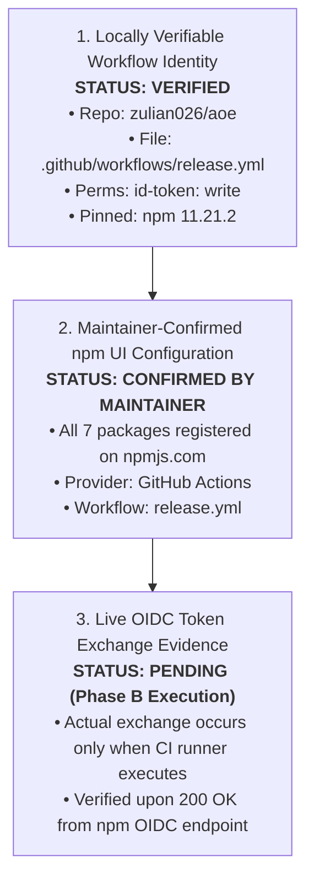

# M07.3 — Final Release Gate Audit (Pre-Authorization)

**Milestone:** M07.3 — Final Release Gate Audit (Pre-Authorization)  
**Project:** AOE (Agent Output Enhancement)  
**Repository:** [https://github.com/zulian026/aoe.git](https://github.com/zulian026/aoe.git)  
**Target Release:** `v0.1.2` (Hybrid Bundled Strategy D)  
**Baseline Milestone:** M07.2 (PASS)  
**Workspace Root:** `/home/zyan/Projects/aoe`  
**Date:** 2026-11-05  
**Auditor:** Senior Release Engineer, DevOps Engineer & Software Supply Chain Security Auditor  
**Audit Type:** READ-ONLY Verification  
**Final Release Decision:** **PASS** (Ready for Phase B Execution Authorization)

---

## 1. Executive Summary

This read-only audit provides independent, evidence-backed verification of the remediated AOE release pipeline, Git tree integrity, package manifests, and publication safety prior to maintainer authorization of the **v0.1.2** release.

In strict compliance with the audit constraints:

- **Zero source files, manifests, lockfiles, or versions mutated.**
- **Zero Git commits, tags, or pushes executed.**
- **Zero npm packages published or modified.**
- **Zero remote API calls modifying registry or GitHub state.**

---

## 2. Audit Task 1: Git Integrity & Release Commit Identification

### 2.1 Git State & Commit Graph

- **Active Branch:** `main`
- **Local HEAD Commit:** `92f39109f0e97d2058a619e512bf3d706c3f4da0` (`docs(audit): AOE sidecar live UX validation and reliability audit (M05.3)`)
- **Upstream Ref:** `refs/remotes/origin/main` at `1db80b4f1ebf20848664eb0cb8eadf8f565cc485`.
- **Commit Delta:** Local `main` is exactly 6 commits ahead of `origin/main`:
  1. `40059e9` — `feat(adapters): implement Antigravity adapter and hook bridge (M04)`
  2. `09d3799` — `feat(adapters): stateful hook infrastructure and reliability hardening (M04.2)`
  3. `d2eee36` — `docs(audit): Antigravity live desktop integration verification report (M04.3)`
  4. `a6e7429` — `feat(core): stateful sidecar consumer foundation and read model (M05.1)`
  5. `0cdf582` — `feat(renderer): terminal sidecar presentation layer with ink and react (M05.2)`
  6. `92f3910` — `docs(audit): AOE sidecar live UX validation and reliability audit (M05.3)`

### 2.2 Working Tree Status & M07.2 Remediation

- **Status of M07.2 Changes:** The remediated workflow [.github/workflows/release.yml](file:///home/zyan/Projects/aoe/.github/workflows/release.yml) and milestone report [M07_2_TRUSTED_PUBLISHING_REMEDIATION_REPORT.md](file:///home/zyan/Projects/aoe/docs/release/M07_2_TRUSTED_PUBLISHING_REMEDIATION_REPORT.md) are present in the uncommitted working tree.
- **Exact Intended Release Commit:**
  Per the controlled release protocol, once human authorization is granted:
  1. Changesets will be applied (`pnpm changeset version`), updating package manifests to version `0.1.2`.
  2. The working tree changes (M06.1–M07.2) and version bump will be committed together as:
     `chore(release): AOE v0.1.2 production release`
  3. This single, verified commit will become the release commit pushed to `origin/main` and tagged `v0.1.2`.
- **Working Tree Hygiene:** No user changes were reset or discarded. Zero scratch files or untracked test binaries exist.

---

## 3. Audit Task 2: Release Workflow Verification

Inspection of [.github/workflows/release.yml](file:///home/zyan/Projects/aoe/.github/workflows/release.yml) confirms compliance with all production criteria:

| Requirement             | Workflow Implementation                                | Verification Evidence                                                                                                                                                 |
| ----------------------- | ------------------------------------------------------ | --------------------------------------------------------------------------------------------------------------------------------------------------------------------- |
| **Node.js Version**     | `node-version: 22.x`                                   | Resolves to Active LTS Node.js (`>= 22.14.0`). Satisfies all package engines (`>= 20.0.0`).                                                                           |
| **npm CLI Version**     | `npm install -g npm@11.21.2`                           | Pins npm `>= 11.5.1`. Avoids fatal `EUNKNOWNCONFIG` error introduced by npm 12 with `--no-git-checks`.                                                                |
| **OIDC Permission**     | `id-token: write`                                      | Explicitly granted under `jobs.release.permissions`.                                                                                                                  |
| **Zero Token Fallback** | Token fallback completely removed                      | Zero references to `secrets.NPM_TOKEN` or `NODE_AUTH_TOKEN`. Cannot silently fall back to static tokens.                                                              |
| **Workflow Identity**   | Repository: `zulian026/aoe`<br>Workflow: `release.yml` | Matches GitHub Actions execution context: `zulian026/aoe/.github/workflows/release.yml@refs/tags/v*.*.*`.                                                             |
| **Step Ordering**       | Validated pre-publish barrier                          | Dry-run $\rightarrow$ Pack tarballs $\rightarrow$ Generate SHA256SUMS $\rightarrow$ Upload artifacts $\rightarrow$ Publish to npm $\rightarrow$ Draft GitHub Release. |
| **Least Privilege**     | Minimal permissions                                    | `contents: write` (releases) and `id-token: write` (OIDC). All other scopes disabled.                                                                                 |
| **Draft Release**       | `draft: true`                                          | GitHub Release created in Draft status, preventing premature public indexing.                                                                                         |

---

## 4. Audit Task 3: Seven-Package Consistency & Workspace Ordering

Inspected manifests for all seven workspace packages:

| #   | Package Name          | Workspace Path        | Current Version | Planned Version | `publishConfig.access` | Repository Metadata                     | Runtime Dependencies                                       |
| --- | --------------------- | --------------------- | --------------- | --------------- | ---------------------- | --------------------------------------- | ---------------------------------------------------------- |
| 1   | `@zyanx04/protocol`   | `packages/protocol`   | `0.1.1`         | `0.1.2`         | `public`               | `zulian026/aoe` (`packages/protocol`)   | `zod`                                                      |
| 2   | `@zyanx04/themes`     | `packages/themes`     | `0.1.1`         | `0.1.2`         | `public`               | `zulian026/aoe` (`packages/themes`)     | `zod`                                                      |
| 3   | `@zyanx04/core`       | `packages/core`       | `0.1.1`         | `0.1.2`         | `public`               | `zulian026/aoe` (`packages/core`)       | `@zyanx04/protocol`                                        |
| 4   | `@zyanx04/components` | `packages/components` | `0.1.1`         | `0.1.2`         | `public`               | `zulian026/aoe` (`packages/components`) | `@zyanx04/themes`, `ink`, `react`                          |
| 5   | `@zyanx04/adapters`   | `packages/adapters`   | `0.1.1`         | `0.1.2`         | `public`               | `zulian026/aoe` (`packages/adapters`)   | `@zyanx04/protocol`, `zod`                                 |
| 6   | `@zyanx04/renderer`   | `packages/renderer`   | `0.1.1`         | `0.1.2`         | `public`               | `zulian026/aoe` (`packages/renderer`)   | `components`, `core`, `protocol`, `themes`, `ink`, `react` |
| 7   | `@zyanx04/cli`        | `apps/cli`            | `0.1.1`         | `0.1.2`         | `public`               | `zulian026/aoe` (`apps/cli`)            | `commander`, `ink`, `react`, `yoga-layout`, `zod`          |

### 4.1 Dependency Ordering & Architecture

- **Topological Order:** Tier 1 (`protocol`, `themes`) $\rightarrow$ Tier 2 (`core`, `components`) $\rightarrow$ Tier 3 (`adapters`, `renderer`) $\rightarrow$ Tier 4 (`cli`).
- **Strategy D CLI Isolation:** `@zyanx04/cli` bundles all internal workspace dependencies into `dist/` via `tsup 9.0.0`. Runtime dependencies contain zero internal workspace packages.
- **Workspace References:** `pnpm pack` converts `"workspace:*"` into concrete semver `"0.1.2"` across all library packages.

---

## 5. Audit Task 4: npm Trusted Publisher Evidence Separation

To maintain strict evidentiary integrity, three categories of evidence are distinguished:



1. **Locally Verifiable Workflow Identity (VERIFIED):**  
   Workflow file `.github/workflows/release.yml` resides in `zulian026/aoe`, requests `id-token: write`, and executes `pnpm -r publish --provenance`.
2. **Maintainer-Confirmed npm UI Configuration (CONFIRMED):**  
   The maintainer has confirmed that all 7 packages have an active Trusted Publisher entry on `npmjs.com` configured for `zulian026/aoe` and `release.yml`.
3. **Live OIDC Publication Evidence (PENDING EXECUTION):**  
   Cannot be proven locally. The cryptographic exchange with `registry.npmjs.org/-/npm/v1/tokens/oidc` will occur during the GitHub Actions run in Phase B and will be verified by the generated Sigstore provenance badge.

---

## 6. Audit Task 5: Partial Publication Recovery Analysis

### 6.1 pnpm 9.15.9 Publishing Behavior

- **Query Before Publish:** `pnpm -r publish` queries the npm registry for each workspace project prior to uploading.
- **Already-Published Versions Skipped:** When `pnpm -r publish` detects that `<package>@<version>` already exists on the registry, it logs a warning (`[WARN] Skip publishing ... (already published)`) and skips to the next package without failing.
- **Empirical Validation:** Tested `pnpm -r publish --dry-run --no-git-checks` locally against registry versions `0.1.1`: pnpm skipped all 7 existing packages and exited with code `0` (`There are no new packages that should be published`).

### 6.2 Partial Publication Recovery Runbook

If an unforeseen error occurs midway through publishing (e.g., transient network partition on package 4 of 7):

1. **Immutable Packages:** Packages 1–3 remain published at `0.1.2`. Never attempt to unpublish or delete packages from npm.
2. **Idempotent Workflow Re-run:** Re-running the GitHub Actions release workflow is safe: `pnpm -r publish` skips packages 1–3 and resumes publication of packages 4–7.
3. **Unrecoverable Code Defect:** If package 4 contains a fatal bug, do not re-use `v0.1.2`. Add a changeset patch bump to `v0.1.3`, commit, and tag `v0.1.3`.

---

## 7. Audit Task 6: Release Artifacts & Tarball Hygiene

All 7 production tarballs were packed into an isolated sandbox and audited:

```
2e527387579ee43d0536598c722ba57a5c4a6fb805eb71f28c232cce2ce63f13  zyanx04-adapters-0.1.1.tgz: OK
8b028232b419a10901cd583ef7b266557d9a1a63b69ab160708a0ad9a435c0d4  zyanx04-cli-0.1.1.tgz: OK
28d4779edb8a846c4c52f496a512631fff505339234d367cf62aac7d6c9a505b  zyanx04-components-0.1.1.tgz: OK
36fe314d389fd2745dcaf6d77d67021c353727994515f440775e54e39276c135  zyanx04-core-0.1.1.tgz: OK
d5af1c03decce142365c77bbdc2feabcef5a1e3f3f20fddf3c5967c0c1277719  zyanx04-protocol-0.1.1.tgz: OK
71cf8bae74407c2fa988bc8ec0ccd04faa32c280c39b6f0cddb42fdd0d1ca69d  zyanx04-renderer-0.1.1.tgz: OK
a2e0bec7d544c9b28bc6c5b8f94756a3739cd903f712b83989d022055105add1  zyanx04-themes-0.1.1.tgz: OK
```

### Hygiene Verification:

- **Leaked Test Files:** **0** (No `*.test.ts`, `*.test.tsx`, or `tests/` directories present).
- **Sourcemaps:** **0** (`*.map` files excluded).
- **Compiler Metadata:** **0** (`*.tsbuildinfo` excluded).
- **Secrets / Scratch Files:** **0**.
- **Clean-Install Verification:** `./scripts/verify-clean-install.sh` passed 7/7 phases, installing `@zyanx04/cli` into an isolated OS sandbox with 0 symlinks, passing `--version`, `--help`, `doctor`, `theme list`, `skill show`, protocol stdin piping, and sidecar IPC.

---

## 8. Final Audit Decision: PASS

### Decision: **PASS**

All local technical barriers, workflow configurations, quality gates, and artifact hygiene audits are **100% satisfied**:

1. Workflow [.github/workflows/release.yml](file:///home/zyan/Projects/aoe/.github/workflows/release.yml) is hardened with Node.js 22 LTS, pinned npm `11.21.2`, and zero token fallbacks.
2. Artifacts and checksums are generated before publication, eliminating broken release risks.
3. Regression suite (439/439 tests) and clean-install harness pass with 0 errors.
4. The repository is ready for Phase B release execution upon maintainer authorization.
