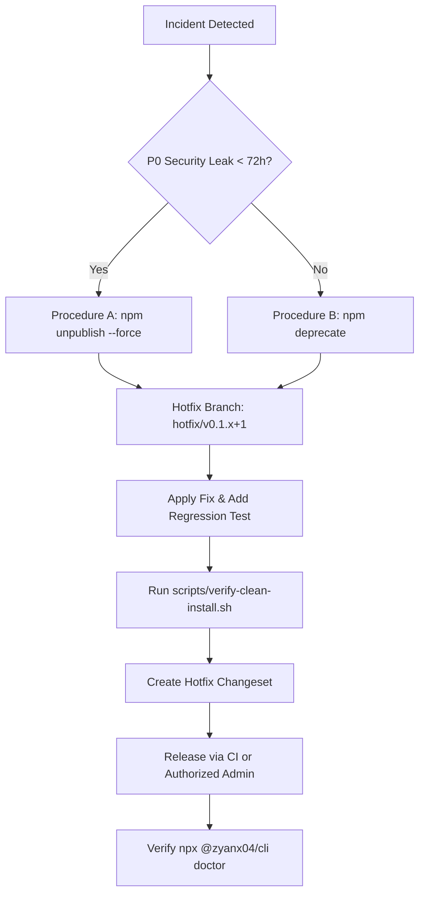

# AOE Release Rollback & Emergency Incident Plan

## Document Metadata

- **System**: AOE — Agent Output Enhancement
- **Target Package**: `@zyanx04/cli`
- **Monorepo Packages**: `@zyanx04/protocol`, `@zyanx04/themes`, `@zyanx04/core`, `@zyanx04/components`, `@zyanx04/adapters`, `@zyanx04/renderer`, `@zyanx04/cli`
- **Author**: Senior Release Engineering & Supply Chain Security Auditor
- **Status**: ACTIVE RUNBOOK
- **Last Verified**: 2026-11-05

---

## 1. Objectives & Scope

This runbook defines the authoritative recovery, deprecation, and rollback procedures for published npm packages and GitHub releases of AOE.

The objectives are:

1. Prevent catastrophic supply-chain or runtime impact from a flawed or compromised release.
2. Comply strictly with public npm registry unpublishing policies.
3. Provide deterministic, step-by-step remediation procedures with zero guessing during an active incident.

---

## 2. Trigger Conditions & Incident Severity

| Severity                        | Definition                                                                                           | Examples                                                                                      | Immediate Action                                                                                   |
| :------------------------------ | :--------------------------------------------------------------------------------------------------- | :-------------------------------------------------------------------------------------------- | :------------------------------------------------------------------------------------------------- |
| **P0 — CATASTROPHIC**           | Active security vulnerability, credential leak, malicious code injection, or critical data loss bug. | Leaked private key, Trojan payload, catastrophic disk corruption in hook bridge.              | Execute **Procedure A (Unpublish)** if < 72h, or **Procedure B (Deprecate + Hotfix)** immediately. |
| **P1 — CRITICAL BREAKAGE**      | Package fails immediately upon install or standard invocation across target platforms.               | Missing bundled chunk, crash on `node -v` >= 20, syntax error in shebang, broken postinstall. | Execute **Procedure B (Deprecate + Hotfix)** within 2 hours.                                       |
| **P2 — DEGRADED FUNCTIONALITY** | Non-critical feature failure, edge-case platform regression, formatting anomaly.                     | ANSI rendering glitch on Windows Terminal, Antigravity socket timeout edge case.              | Issue patch release (`v0.1.x+1`); deprecation optional.                                            |

---

## 3. npm Registry Policy Constraints (The 72-Hour Rule)

The public npm registry enforces strict unpublishing rules ([npm Unpublish Policy](https://docs.npmjs.com/policies/unpublish)):

1. **Within 72 Hours of Publication**:
   - A specific version may be unpublished **ONLY IF**:
     - No other package on the public registry depends on that exact version.
     - The version has had fewer than 300 downloads over the prior week (for older packages).
   - Once a version string (e.g. `0.1.2`) is unpublished, **THAT EXACT VERSION STRING CAN NEVER BE RE-USED**. npm versions are permanently immutable.
2. **After 72 Hours of Publication**:
   - Versions **CANNOT** be unpublished under standard operations.
   - Deprecation via `npm deprecate` is the mandatory public remediation mechanism.
   - For severe security incidents beyond 72 hours, npm Support (`security@npmjs.com`) must be contacted directly.

---

## 4. Remediation Runbooks

### Procedure A: Emergency Version Unpublish (< 72 Hours, P0 Incidents Only)

> [!CAUTION]
> Unpublishing breaks downstream CI/CD pipelines that resolved the package. Use only for catastrophic P0 incidents within the first 72 hours of publication.

1. **Verify Unpublish Eligibility**:
   ```bash
   # Check publish timestamp
   npm view @zyanx04/cli@<version> time
   ```
2. **Execute Unpublish**:
   ```bash
   # Unpublish specific vulnerable CLI version
   npm unpublish @zyanx04/cli@<version> --force

   # If workspace library packages were also published simultaneously:
   for pkg in protocol themes core components adapters renderer; do
     npm unpublish @zyanx04/$pkg@<version> --force
   done
   ```
3. **Verify Removal from Registry**:
   ```bash
   npm view @zyanx04/cli versions --json
   ```
4. **Repoint `latest` Dist-Tag if necessary**:
   ```bash
   # Point 'latest' tag back to previous verified good version
   npm dist-tag add @zyanx04/cli@<previous-good-version> latest
   ```

---

### Procedure B: Package Deprecation (Standard & > 72 Hours)

Deprecation warns all users on `npm install` and CLI invocations without breaking existing build lockfiles or CI pipelines.

1. **Execute Deprecation Command**:
   ```bash
   # Mark the affected version as deprecated with a clear warning message
   npm deprecate @zyanx04/cli@<version> "CRITICAL: This version contains a known defect. Please upgrade immediately to @zyanx04/cli@<patched-version>."
   ```
2. **Deprecate Associated Workspace Packages (if published)**:
   ```bash
   for pkg in protocol themes core components adapters renderer; do
     npm deprecate @zyanx04/$pkg@<version> "Deprecated alongside @zyanx04/cli@<version>."
   done
   ```
3. **Ensure `latest` Dist-Tag Does Not Point to Deprecated Version**:
   ```bash
   npm dist-tag add @zyanx04/cli@<previous-good-version> latest
   ```
4. **Verify Registry Status**:
   ```bash
   npm view @zyanx04/cli deprecated
   ```

---

### Procedure C: Emergency Hotfix Release Protocol

When an incident occurs, the primary forward recovery is releasing an immediate hotfix (`0.1.x+1`).



1. **Create Isolated Hotfix Branch**:
   ```bash
   git checkout -b hotfix/remediate-<incident-id> main
   ```
2. **Apply Remediation Code Change**:
   - Commit minimal, targeted fix.
   - Include regression test in `apps/cli/src/tests/` or relevant package.
3. **Validate Locally**:
   ```bash
   pnpm clean && pnpm build
   pnpm typecheck
   pnpm test
   ./scripts/verify-clean-install.sh
   ```
4. **Prepare Hotfix Changeset**:
   ```bash
   # Add patch changeset describing emergency remediation
   pnpm changeset
   ```
5. **Merge, Tag, and Release**:
   - Tag hotfix (e.g. `v0.1.3`).
   - Trigger release workflow or publish using authorized OIDC pipeline.

---

### Procedure D: GitHub Release & Git Tag Remediation

If a Git tag or GitHub Release was created for a retracted release:

1. **Mark GitHub Release as Broken / Pre-release**:
   ```bash
   # Update release title and body to warn consumers
   gh release edit v<version> --title "RETRACTED: AOE v<version>" --notes "DO NOT USE: This release has been retracted due to an incident. Refer to advisory."
   ```
2. **Do NOT Delete Git Tags if Pushed Publicly**:
   - Deleting remote Git tags causes cache corruption in Go/Cargo/npm proxies and breaks git submodules.
   - Instead, supersede with the next incremented tag.

---

## 5. Post-Incident Review & Checklist

Following resolution of any P0 or P1 incident:

- [ ] Complete incident timeline within 24 hours.
- [ ] Root-cause analysis (RCA) documented in `docs/incidents/`.
- [ ] Automated regression test merged preventing identical defect.
- [ ] Dependency lockfile audited and verified.
- [ ] npm audit and security scans confirmed 100% clean.
